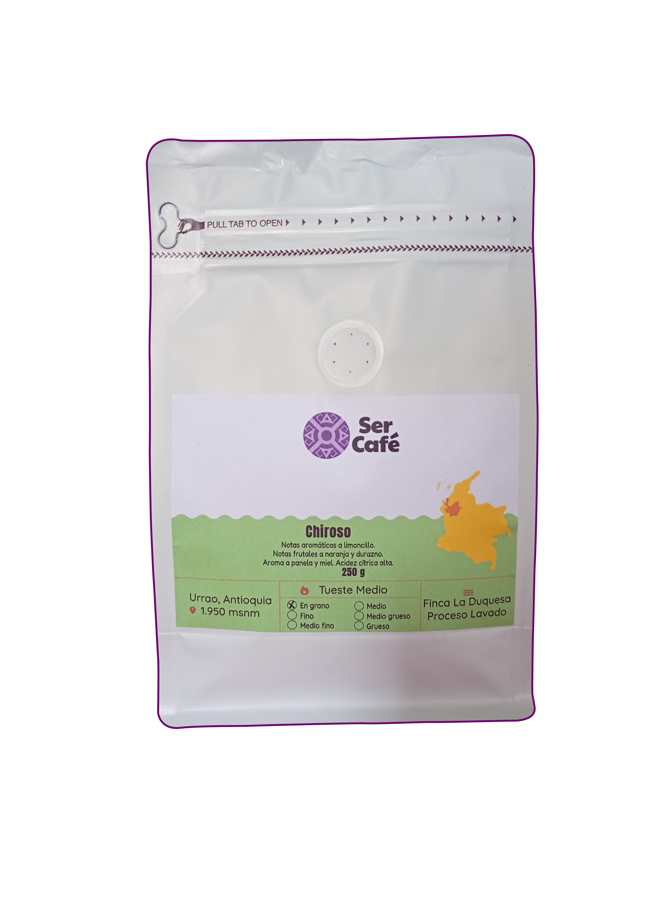

# Optimización de imágenes — Ser Café

## El problema

La carpeta `Img/` pesa **~98 MB**. Varias imágenes son enormes para una web:

| Archivo | Peso actual | Resolución |
|---|---|---|
| `CH-2500gr.png` | 14 MB | — |
| `CT-2500gr.png` | 14 MB | — |
| `Nosotros_costumbres.jpg` | 8.4 MB | — |
| `CT-500gr.png` | 6.5 MB | — |
| `CH-250gr.png` | 4.4 MB | 5751×8001 px |
| `CT-250gr.png` | 4.4 MB | 5751×8001 px |
| `video-cafe.mp4` | 16 MB | — |

Una resolución de 5751×8001 px es muchísimo más de lo que necesita cualquier
pantalla. **Esto es lo que hace lenta la carga de la página.**

## Qué ya se hizo en el código (sin reencodear)

Estas mejoras ya están aplicadas y ayudan de inmediato:

- `loading="lazy"` + `decoding="async"` en imágenes de catálogo, carrito,
  perfil y secciones internas → el navegador solo descarga las imágenes
  cuando se acercan a la pantalla.
- `fetchpriority="high"` en las imágenes "hero" de cada página → la imagen
  principal carga primero.

## Qué falta (comprimir/convertir de verdad)

La conversión real de PNG/JPG a WebP **no se puede hacer en el sandbox de Kiro**
porque no tiene acceso a internet ni librerías de imagen instaladas. Hazlo en tu
equipo con el script incluido `comprimir-imagenes.js`:

```bash
# En la carpeta del repositorio
npm init -y          # solo si no existe package.json
npm install sharp
node comprimir-imagenes.js
```

El script:
1. Redimensiona cualquier imagen con ancho > 1400 px.
2. Genera un `.webp` junto a cada `.png`/`.jpg` (los originales no se tocan).
3. Muestra el ahorro de peso por archivo.

Se esperan reducciones del **80–95 %** (p. ej. un PNG de 14 MB puede quedar en
200–600 KB).

## Cómo usar los WebP generados

Opción simple: cambia las rutas en `newscript.js` y en los HTML, p. ej.
`Img/CH-250gr.png` → `Img/CH-250gr.webp`.

Opción robusta (con respaldo para navegadores viejos): usa `<picture>`:

```html
<picture>
  <source srcset="Img/CH-250gr.webp" type="image/webp">
  
</picture>
```

## Video

`video-cafe.mp4` (16 MB) no se usa actualmente en ninguna página. Si vas a
usarlo, conviene recomprimirlo (p. ej. a ~2–4 MB) o cargarlo con `preload="none"`.
